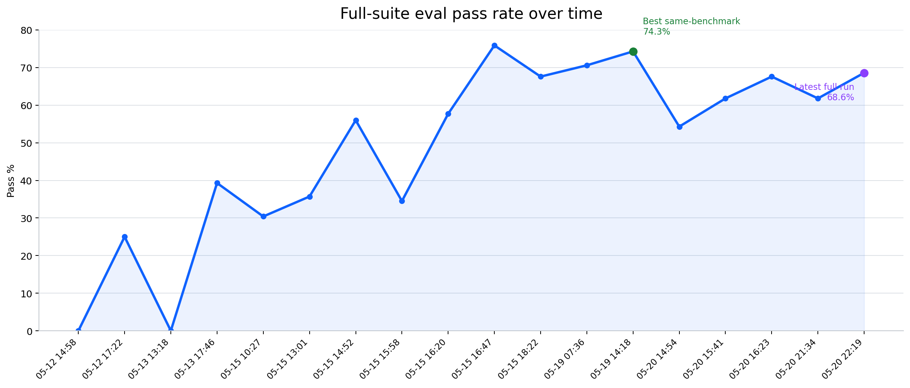

# Using GPT Models for Instance AI

Date: 2026-05-21

## Summary

I looked into Instance AI and its workflow-generation evaluations using GPT models.

- The current setup appears to have been optimized more for non-GPT models than for GPT models.
- Using **GPT-5.5 with high reasoning**, we reached what we should treat as **26/35 (74.3%)**, which is on par with the current external benchmark.
- Most stable consistent full run is **24/35 (68.6%)**, so the main remaining issue is consistency across the full benchmark, not top-end capability.
- I have not yet optimized for lower reasoning settings. We still need to test **medium** and **low / medium** reasoning systematically.
- The main product gap is not understanding the user request. It is building the workflow with the wrong wiring, error handling, or data preservation.
- A second gap is evaluation noise: some failures are runner, verifier, or orchestration failures rather than real builder failures.
- Going forward, I have very concrete suggestions how to improve the system further, but I need n8n team's help.

## What this is based on

Evaluation sources:

- Our best run: `workflow-eval-2026-05-19T14-18-16.html`
- Our latest full run: `workflow-eval-2026-05-20T22-19-00.html`
- External baseline: `sonnet-workflow-eval-2026-05-13T09-16-32.html`

Benchmark shape:

- 14 test cases
- 35 scenarios
- Mix of simple, medium, and complex workflow requests

## Progress so far

Important caveat:

- the benchmark expanded over time from smaller suites to the current **35-scenario** suite
- older percentages are still useful as a progress signal, but they are **not perfectly apples-to-apples**
- the most directly comparable reference point is the **best 35-scenario run**, which we should treat as `26/35 (74.3%)`

The chart below shows the full-suite history from the beginning. It uses a zero-based y-axis so the movement is easier to read.

| Run | Passed | Notes |
| --- | ---: | --- |
| `2026-05-12T14-58-43` | `0/28` (`0.0%`) | Earliest full-suite run on disk |
| `2026-05-12T17-22-36` | `8/32` (`25.0%`) | Early recovery |
| `2026-05-13T13-18-25` | `0/21` (`0.0%`) | Very unstable stage |
| `2026-05-13T17-46-06` | `11/28` (`39.3%`) | Clear improvement over the first day |
| `2026-05-15T10-27-11` | `7/23` (`30.4%`) | Benchmark still smaller than today |
| `2026-05-15T13-01-18` | `5/14` (`35.7%`) | Partial suite / earlier benchmark state |
| `2026-05-15T14-52-28` | `14/25` (`56.0%`) | First major step up |
| `2026-05-15T15-58-24` | `10/29` (`34.5%`) | Regression after prompt/runtime changes |
| `2026-05-15T16-20-44` | `15/26` (`57.7%`) | Recovery |
| `2026-05-15T16-47-25` | `22/29` (`75.9%`) | Best historical percentage, but on a smaller suite |
| `2026-05-15T18-22-13` | `23/34` (`67.6%`) | Close to current benchmark size |
| `2026-05-19T07-36-57` | `24/34` (`70.6%`) | Strong run before full 35-scenario benchmark |
| `2026-05-19T14-18-16` | `25/35` (`71.4%`) | Best saved run; treat same-benchmark performance as 26/35 (74.3%) |
| `2026-05-20T14-54-21` | `19/35` (`54.3%`) | Broad regression |
| `2026-05-20T15-41-04` | `21/34` (`61.8%`) | One build failure removed a scenario from denominator |
| `2026-05-20T16-23-37` | `23/34` (`67.6%`) | Partial recovery |
| `2026-05-20T21-34-33` | `21/34` (`61.8%`) | Another dip before the latest recovery |
| `2026-05-20T22-19-00` | `24/35` (`68.6%`) | Latest full run |

Interpretation:

- Long-term trend is up.
- Recent regression mostly recovered.
- We are still below the best same-benchmark performance target: `26/35 (74.3%)`.
- Prompt changes can move results quickly, which means the system is still unstable.

## Status quo

Current read:

- The system usually understands **what** workflow to build.
- The planner is usually acceptable.
- The main weakness is the **builder**.
- The second weakness is **orchestrator / verifier stability**.

In plain terms: the model often knows the right automation, but does not yet build it reliably in n8n.

## Comparison against the external baseline

Latest comparison:

- **Ours:** `24/35` (`68.6%`)
- **External baseline:** `26/35` (`74.3%`)

Scenario buckets:

| Bucket | Count |
| --- | ---: |
| Both fail | 5 |
| Ours only fails | 6 |
| Baseline only fails | 4 |

By benchmark complexity:

| Bucket | Simple | Medium | Complex |
| --- | ---: | ---: | ---: |
| Both fail | 0 | 4 | 1 |
| Ours only fails | 1 | 4 | 1 |
| Baseline only fails | 0 | 2 | 2 |

Read:

- The gap is real but small.
- This does not look like “they understand n8n, we do not.”
- It looks like they are currently more consistent on common workflow construction patterns.

## What I changed

I changed three areas:

1. **Planner prompt**
2. **Builder prompt**
3. **One orchestration/runtime path**

### Planner prompt changes

I made the planner structured instead of freeform. It now emits the same behavioral contract shape every time:

- `Outcome`
- `Trigger mode`
- `External systems`
- `Required effects`
- `Required branches`
- `Required data`
- `Explicit constraints`
- `Empty/invalid behavior`
- `Done when`

The verification checkpoint mirrors the same structure. This matters because it makes planner quality inspectable and separates **what** the workflow should do from **how** the builder implements it.

### Active builder prompt rules

1. **Stable decision inputs**
   - Decisions should come from normalized input data, not from downstream side-effect nodes.
   - Example: do not make a reply/validation decision from a Telegram or Slack node output.
   - Exact prompt text: `[N001] When later branching, validation, or user-facing responses depend on normalized input facts, do not read those decision inputs from side-effect node outputs unless that output is explicitly required. Make the decision from the normalized source data, branch before the side-effect node, or explicitly preserve the fields needed for the later decision.`

2. **One downstream item per source item**
   - Mutually exclusive branches should not produce duplicate downstream items.
   - Example: “email sent” and “email skipped” should not both continue into notification/logging paths.
   - Exact prompt text: `[N002] When branches are mutually exclusive outcomes for the same source item (for example attempted vs skipped, success vs fallback, valid vs invalid), downstream side effects must receive exactly one item per original source item. Do not append-merge both branch outputs into later notification, write, or response nodes. Rejoin into a single enriched item or route only the selected branch onward while preserving the original source data.`

3. **Fetch the fields you actually depend on**
   - If downstream logic needs nested or related fields from an external system, the workflow must fetch those fields explicitly.
   - Example: the Linear report improved after forcing explicit field coverage instead of assuming the node returned what was needed.
   - Exact prompt text: `[N007] When downstream logic depends on specific related fields, labels, nested properties, or filters from an external system, do not assume a service-native node returns those fields by default. Fetch the exact fields explicitly using a node configuration that guarantees them; if the native node cannot clearly provide the required fields or query shape, use HTTP Request or the service API directly instead of a more convenient native node. Downstream code must only rely on fields that the upstream fetch is configured to return.`

4. **Keep empty, success, and failure states distinct**
   - An empty result is not the same as an error.
   - When combining multiple sources, the workflow should not mix successful data with synthetic failure records.
   - Exact prompt text: `[N008] When a workflow reads from multiple independent sources and then combines the results, keep empty results, successful reads, and failed reads distinct. An empty result is a successful read with zero items, not a failure. If one source is allowed to fail without stopping the workflow, configure that source node to continue on fail or use an error output, and create a failure record only from the real error path. For each source, downstream merge or aggregation must receive either successful data or one failure record, never both. When some sources succeed and others fail, continue with the successful sources and include a clear note about the failed sources in the final output.`

### Runtime/orchestration fix

5. **Recover or report when the detached builder does not submit the main workflow**
   - This was added because some build failures were caused by the background builder finishing without surfacing a usable workflow result.

### What I tried and rolled back

I also tried broader rules around graceful degradation, narrow validation, multi-source joins, and literal identifier preservation. Some helped single cases but hurt the full suite, so I rolled them back.

## Current failures and why they happen

The latest full run breaks into a few clusters:

| Cluster | Layer | Workflows / scenarios | What is happening |
| --- | --- | --- | --- |
| Partial failure handling | Builder | Contact form `partial-action-failure`; Slack digest `channel-not-found`, `insufficient-permissions` | One external failure stops the whole workflow instead of letting successful branches continue |
| Wrong branch wiring | Builder | Hot city weather `happy-path` | The alert branch is connected to the wrong output, so the workflow runs but the alert never sends |
| Wrong source-of-truth field | Builder | Workflow inventory `happy-path`; Telegram family assistant `distinct-telegram-chat` | The workflow uses a hardcoded or indirect field instead of the real source field |
| Invalid required config | Builder | Linear + BigQuery leaderboard `happy-path` | A required non-secret config value is left as an unusable placeholder |
| Verifier noise | Verifier | Contact form `happy-path`, `missing-fields`, `empty-message`, `invalid-email` | `Error: fetch failed` means the evaluator failed before producing a reliable workflow judgment |

## What is actually failing

| Layer | Read |
| --- | --- |
| Prompt / user request | Usually not the main issue |
| Planner | Usually acceptable |
| Builder | Main source of real failures |
| Orchestrator | Still has some reliability issues |
| Verifier / eval | Sometimes noisy enough to hide the real signal |

Bottom line:

> The system often knows what workflow to build, but it is not yet consistently reliable at building it correctly in n8n.

## Challenges and proposed next steps

### 1. Domain-specific n8n workflow quality

We still need stronger n8n craft knowledge on:

- branch isolation
- empty vs error handling
- safe multi-source merges
- when to prefer HTTP Request over a native node
- correct memory/session-key wiring

__Possible next steps:__

1. Best help: someone strong in real-world n8n design patterns. Hypothesis: Extending the prompt with more n8n context will increase the accuracy.
2. If the prompt improvements are not enough, we may consider to introduce other **context extension** strategies:
   2a. adding (on-demand) complex examples (multi-shot learning) for the builder.
   2b. depending on the depth of your documentation, a websearch could also extend the builder capability
   2c. extending nodes tool with better builderHint
   2d. adding a new tool get "architectures" from best practices
   ...
3. If the model still does not perform well, we can consider a reinforcement fine-tuning approach for the builder with eval as the grader.

### 2. Some failures are not builder problems

Some failures come from:

- detached builder/orchestrator handoff
- verifier `fetch failed` noise
- scenario or mock instability

Best help: someone who understands the orchestrator/verifier boundary deeply.

## Questions for the team

1. Pair on workflow-domain failures, especially partial-failure handling and branch/merge design.
2. Pair on the evaluation stack, especially verifier noise and orchestration failures.

## Suggested next steps

1. Freeze the benchmark baseline and stop broad prompt churn.
2. Separate failures cleanly into builder, runner/orchestrator, verifier, and mock/fixture lanes.
3. Sit together and review the current failures in that order, starting with the highest-leverage builder cluster first.
4. Fix the highest-leverage builder cluster first: partial failure isolation.
5. Reduce verifier noise before drawing strong conclusions, then re-run the full suite after each narrow change.

## Question for Wulfie

> RFT becomes much more attractive once a failure really means “the workflow was wrong.”
